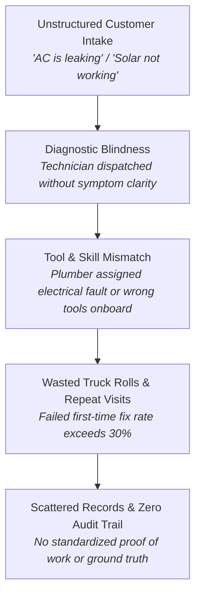
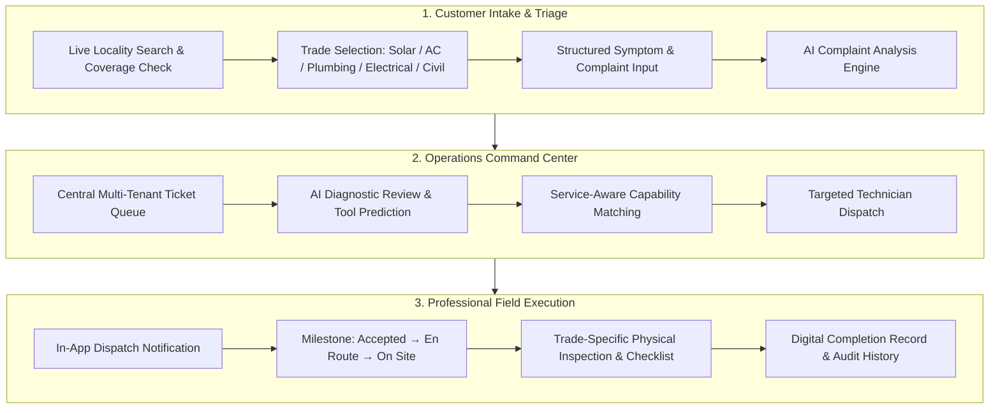
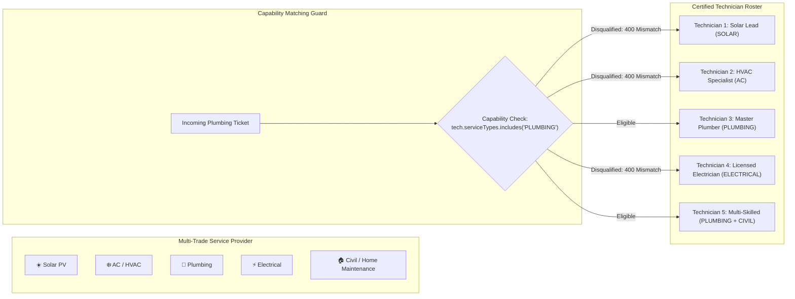
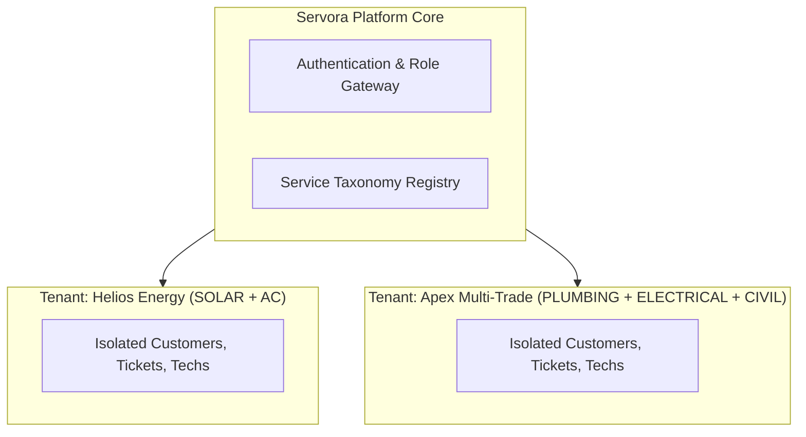
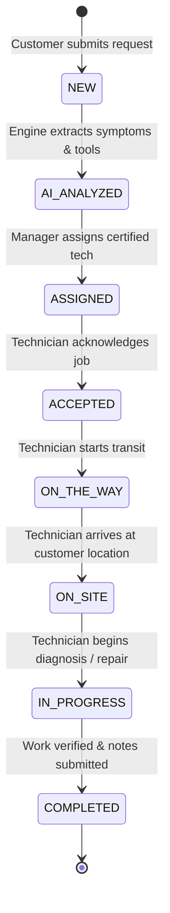
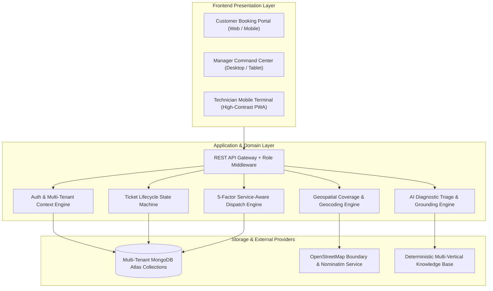

# Servora

## AI-Powered Field Service Operations Platform

[](https://github.com/faizkhatri196/Servora)
[](#8-service-categories)
[](#14-product-architecture)
[](https://www.linkedin.com/company/servoraaiop/)
[](#17-current-product-status)

---

## 1. Product Overview

**Servora** is an enterprise-grade field service operations platform built to modernize physical maintenance, diagnostic triage, and dispatch for distributed service businesses.

Modern residential, commercial, and industrial maintenance companies operate in high-friction environments. Service requests routinely arrive across fragmented channels: phone calls, WhatsApp chats, paper receipts, and unorganized spreadsheets. Dispatchers struggle to match job requirements against technician certifications, tools, and real-time geographic coverage. Technicians arrive on-site with incomplete fault context, lacking necessary replacement parts or precision instruments.

Servora replaces this fragmented patchwork with a unified, end-to-end operational operating system:

```
Customer Problem
       ↓
Location-Aware Discovery & Service Filtering
       ↓
AI Complaint Understanding & Diagnostic Preparation
       ↓
Multi-Tenant Operations Queue
       ↓
Service-Aware Capability Matching & Dispatch
       ↓
Mobile Field Execution & Physical Inspection
       ↓
Tamper-Resistant Milestone Progression & Completion Record
```

---

## 2. The Core Problem

Field service operations across energy, climate, plumbing, electrical, and structural maintenance suffer from five structural bottlenecks:



1. **Intake Ambiguity**: Customers describe complex electromechanical or civil failures in non-technical terms, leaving dispatchers guessing what parts or trades are required.
2. **Capability Misalignment**: Traditional dispatching routes jobs based strictly on distance rather than certified trade capabilities, resulting in cross-domain dispatch errors (e.g., dispatching solar specialists to plumbing emergencies).
3. **Pre-Arrival Diagnostic Blindness**: Field personnel enter client premises without preliminary checklists, diagnostic schematics, or required safety protocols.
4. **Unverified Field Execution**: Work completion relies on verbal confirmations or unstructured photos rather than calibrated measurement checklists, safety validations, and structured observation records.
5. **Data Silos in Multi-Trade Businesses**: Companies offering multiple trades manage each team through separate channels, destroying operational visibility and customer continuity.

---

## 3. The Servora Solution

Servora bridges the gap between client problem intake and verified physical field resolution through four core pillars:

- **Location-First Service Availability**: Real-time geographic boundary and locality validation ensuring requests only enter active operational coverage zones.
- **Intelligent Intake & AI Diagnostic Triage**: Structured symptom normalization, candidate cause modeling, required tool forecasting, and mandatory safety advisories generated at request creation.
- **Service-Aware Capability Dispatch**: Deterministic 5-factor scoring engine that mathematically prevents cross-domain technician mismatch and optimizes for certification, tools, distance, and availability.
- **Standardized Field Execution Pipeline**: Mobile-responsive milestone workflows guiding professionals from dispatch acceptance through on-site physical measurement, observation recording, and customer handoff.

---

## 4. How Servora Works



---

## 5. Customer Experience

The customer journey is designed for frictionless, location-aware service booking without requiring account creation:

1. **Location-First Discovery**: Customers specify their locality via live search. Servora validates administrative boundaries and coordinates in real-time. Only services actively covered by licensed providers in that geographic zone are presented.
2. **Trade & Problem Selection**: Clear visual taxonomies for Solar Energy, AC/HVAC, Plumbing, Electrical, and Home Maintenance. Customers pick specific problem categories (e.g., *Inverter Tripping*, *Compressor Failure*, *Water Leakage*, *MCB Sparking*, *Tile Replacement*).
3. **Structured Complaint Input**: Intuitive text and voice-assisted intake capturing exact operational symptoms.
4. **Calibrated Evidence Collection**: Dynamic media requirements based on problem category. High-visibility issues require photo uploads (e.g., damaged piping or inverter LCD codes), while acoustic or odor issues bypass camera requirements to prevent unnecessary friction.
5. **Instant AI Diagnostic Feedback**: Customers receive immediate reassurance with an AI-generated intake summary detailing understood symptoms and expected technician preparation.
6. **Real-Time Status Tracking**: Live ticket tracker displaying operational milestones: `NEW` $\to$ `ASSIGNED` $\to$ `ACCEPTED` $\to$ `ON THE WAY` $\to$ `ON SITE` $\to$ `COMPLETED`.

---

## 6. AI-Powered Complaint Understanding

Servora features an integrated diagnostic intake engine that translates informal customer descriptions into structured engineering hypotheses:

### Example Input
> *"Water is leaking heavily from the pipe below my bathroom sink and the cabinet wood is getting soaked."*

### AI Engine Output

```json
{
  "serviceType": "PLUMBING",
  "category": "PIPE_LEAKAGE",
  "urgency": "HIGH",
  "probableCauses": [
    "P-trap slip joint washer deterioration or displacement",
    "Compression valve fitting failure at cold/hot supply riser",
    "Threaded tailpiece corrosion under high household water pressure"
  ],
  "recommendedTools": [
    "PIPE_WRENCH",
    "BASIN_WRENCH",
    "TEFLON_THREAD_TAPE",
    "COMPRESSION_SLEEVE_PULLER"
  ],
  "safetyAdvisory": [
    "Locate and close the fixture isolation valve or main water stopcock immediately",
    "Keep electrical outlets and appliances in the vicinity isolated from standing water"
  ],
  "missingInformation": [
    "Confirmation whether leakage occurs continuously or only when tap is running"
  ]
}
```

### Safety & Operational Guardrails
- **Assistance, Not Final Diagnosis**: All AI recommendations are explicitly categorized as operational hypotheses. Technicians must conduct physical inspections on-site to verify or refute candidate causes.
- **Provider Implementation**: Powered by Servora's deterministic multi-trade engineering rules engine (`DemoAIProvider`), ensuring zero API downtime, deterministic reproducibility, and zero exposure of private customer data. Optional cloud LLM grounding adapters (Google Gemini / Groq LLaMA) integrate seamlessly where cloud intelligence is configured.

---

## 7. Service-Aware Operations

Servora treats trades as modular operational domains. Organizations define which services they license, and technician eligibility is governed strictly by verifiable capabilities:



### Capability Guarantees
- A Solar technician can **never** be dispatched to an Electrical or Plumbing ticket unless certified in that secondary domain.
- The matching engine ranks technicians by:
  1. **Trade Certification Match (Mandatory)**
  2. **Required Onboard Tools Verification**
  3. **Duty Status & Real-Time Availability**
  4. **Geographic Proximity & Coverage Radius**
  5. **Domain Experience & Past Fix Rating**

---

## 8. Service Categories

Servora supports five verified trade verticals across all system layers:

| Trade | Icon | Supported Problem Taxonomy | Required Toolsets & Equipment | Mandatory Safety Protocols |
| :--- | :---: | :--- | :--- | :--- |
| **Solar Photovoltaics** | ☀️ | Inverter Error Codes, Zero Generation, Solar Panel Physical Damage, High DC Voltage Faults, Structure Earthing | Multimeter, Clamp Meter, MC4 Crimper, Irradiance Meter, Thermal Camera | Rooftop Fall Harness, DC Disconnect Isolation, Lockout-Tagout (LOTO), Arc Flash PPE |
| **AC / HVAC Systems** | ❄️ | No Cooling / Low Airflow, Water Dripping, Gas Pressure Leak, Compressor Trip, Blower Noise | Manifold Gauge Set, Vacuum Pump, Refrigerant Canister, Amperage Clamp, Leak Detector | Main Circuit Isolation, Refrigerant Handling Compliance, Condenser Fan Pinch Guards |
| **Plumbing & Water** | 🔧 | Pipe Burst / Joint Leakage, Drain Blockage, Pressure Pump Failure, Low Water Pressure, Fixture Replacement | Pipe Wrench, Basin Wrench, Teflon Tape, Plumber Snake, Compression Crimper | Stopcock Water Isolation, Sump Valve Lockout, Slip Hazard Mitigation |
| **Electrical Systems** | ⚡ | MCB Tripping, Short Circuits, Switchboard Burnout, Voltage Fluctuations, Grounding Leakage | Digital Multimeter, Insulated Screwdriver Set (1000V), Wire Stripper, Continuity Tester | Mains Sub-Panel Breaker Lockout, Rubber Insulated Gloves, Voltage Absence Verification |
| **Home Maintenance** | 🏠 | Floor / Wall Tile Replacement, Seepage Dampness, Plaster Cracks, Door Alignment, Waterproofing | Notched Trowel, Tile Cutter, Grout Float, Moisture Meter, Rubber Mallet | Dust Respirator Mask, Safety Goggles, Structural Weight Precautions |

---

## 9. Professional Workflow

Field technicians interface with a purpose-built, high-contrast mobile terminal:

```
Assigned Work Queue
       ↓
Job Acceptance (ACCEPTED)
       ↓
Travel Notification (ON THE WAY)
       ↓
Customer Site Arrival (ON SITE)
       ↓
Safety Pre-Check & Trade Inspection
       ↓
Execution Checklist & Field Observations
       ↓
Job Completion & Customer Verification (COMPLETED)
```

- **Touch-Optimized**: Calibrated touch targets ($\ge 44\text{px}$) designed for one-handed and gloved operation in outdoor daylight.
- **Trade-Calibrated Checklists**: Plumbing jobs prompt for pipe inspection and joint pressure verification; Solar jobs prompt for voltage readings and DC isolation; Electrical jobs enforce breaker lockout confirmation.
- **Tamper-Resistant Timestamps**: Every milestone records an immutable operational timestamp for customer transparency and billing precision.

---

## 10. Manager Operations

The Operations Command Center equips service managers with end-to-end operational control:

- **Unified Pipeline Queue**: Real-time filtering across trades (`SOLAR`, `AC`, `PLUMBING`, `ELECTRICAL`, `HOME_MAINTENANCE`), status stages, and priority tiers.
- **AI Triage Inspection**: Managers review symptom extractions, probable causes, and safety warnings prior to dispatch.
- **5-Factor Dispatch Recommendation**: One-click recommendation modal ranking candidate technicians by match percentage, displaying clear explanations for disqualified candidates.
- **Real-Time Technician Telemetry**: Status indicators showing which technicians are `AVAILABLE`, `ON_DUTY`, `EN_ROUTE`, or `ON_SITE`.
- **Quality Assurance & Audit Logs**: Full chronological event trail on every service request from submission to post-service resolution.

---

## 11. Location & Service Coverage

Servora features a strict location verification architecture:

```mermaid
graph TD
    A["Customer Address Input"] --> B["Live OpenStreetMap Geocoding"]
    B --> C{"Coordinate & Boundary Validation"}
    C -->|Invalid Coords [0,0] / Out of Range| D["Explicit Rejection with User Notice"]
    C -->|Valid Coordinates| E["Geospatial Radius Check Against Providers"]
    E --> F{"Active Coverage Found?"}
    F -->|No Coverage| G["Informative Out-of-Area Notice"]
    F -->|Coverage Active| H["Filter Services to Provider Enabled Capabilities"]
```

- **Zero Guessing / Fallbacks**: Coordinates such as `[0, 0]` are rejected. The system never silently substitutes arbitrary default cities.
- **Deterministic Administrative Scoping**: Service availability reflects actual licensed provider operating radii and verified pincodes.

---

## 12. Multi-Tenant Business Model

Servora provides strict logical isolation between independent service businesses:



- **Company Isolation**: Every database operation enforces strict tenant boundary scoping (`companyId`). No service provider can view another company's tickets, customer records, or staff.
- **Configurable Service Portfolios**: Providers independently toggle supported trades based on their licensing and workforce composition.

---

## 13. Status Lifecycle

Service requests progress through an auditable, finite-state lifecycle:



---

## 14. Product Architecture



---

## 15. Data & Operations Flow

1. **Intake Event**: Customer registers a complaint with validated coordinates and category selection.
2. **Analysis Event**: AI engine normalizes unstructured symptoms into candidate root causes, recommended toolkits, and safety requirements.
3. **Dispatch Event**: Operations manager triggers capability matching; system scores and validates available technicians against the ticket's trade.
4. **Field Event**: Technician receives real-time notification, confirms transit, checks in on site, and executes trade-specific checklist.
5. **Completion Event**: Technician logs physical observations and resolution steps, transitioning the ticket to `COMPLETED` and archiving the historical service record.

---

## 16. Security & Isolation

- **Role-Based Access Control (RBAC)**: Strict segregation between `CUSTOMER`, `TECHNICIAN`, `MANAGER`, and `ADMIN`. Technicians attempting to access manager dispatch or analytics endpoints receive immediate `403 Forbidden` responses.
- **Tenant Scoping**: All database queries enforce tenant isolation at the query execution level.
- **Privacy Protection**: Customer telephone numbers and precise addresses are obscured from technicians until an assignment is actively accepted.
- **Cryptographic Security**: Salted password hashing, stateless signed session tokens, and zero credentials committed to source control.

---

## 17. Current Product Status

- **Unit & Integration Test Coverage**: 109/109 automated tests passing across 14 test suites.
- **Production Builds**: Backend (`tsc`) and Frontend (`vite build`) passing with zero compile errors.
- **Verified Trade Verticals**:
  - ☀️ Solar Photovoltaic (PV) — **Production Ready**
  - ❄️ AC / HVAC — **Production Ready**
  - 🔧 Plumbing — **Production Ready**
  - ⚡ Electrical — **Production Ready**
  - 🏠 Home Maintenance / Civil — **Production Ready**
- **Dynamic Routing**: Verified zero hardcoded technician names; routing strictly governed by `serviceTypes` capabilities.

---

## 18. Product Demo

Experience Servora in action:

- **Interactive In-App Walkthrough**: Launch the interactive product walkthrough at `/walkthrough` to scrub through all 8 operational milestones with live telemetry and HUD inspection.
- **Platform Demonstration Video**: [Servora 3-Minute Platform Walkthrough](./SERVORA_3MIN_YC_DEMO.mp4) (High-Definition operational recording showing customer intake, AI triage, manager dispatch, and field technician execution).

---

## 19. Why Servora

| Without Servora | With Servora |
| :--- | :--- |
| Customer complaints lost in WhatsApp chats and phone logs | Centralized, location-validated intake portal with instant confirmation |
| Technicians arrive with zero diagnostic context or wrong tools | Pre-arrival AI diagnostic packages with tool forecasts and safety checklists |
| Technicians dispatched by guesswork, causing trade mismatch | Deterministic 5-factor scoring enforcing certified service capabilities |
| Paper receipts and unverifiable verbal updates | Real-time milestone tracking with auditable digital completion records |
| Separate tools needed for Solar, AC, Plumbing, and Maintenance | One unified, modular multi-trade platform serving all field operations |

Servora is designed to turn fragmented field service businesses into structured, high-margin, scalable operations.

---

## 20. Connect with Servora

- 💼 **LinkedIn**: [Servora Technologies on LinkedIn](https://www.linkedin.com/company/servoraaiop/)
- 🌐 **Platform**: Field Service Operations & Intelligent Dispatch Automation
- 🔒 **Intellectual Property**: Copyright © 2026 Servora Technologies. All rights reserved.