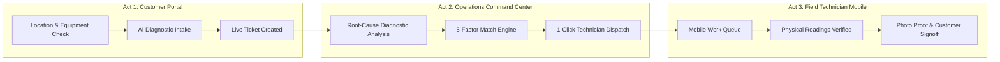
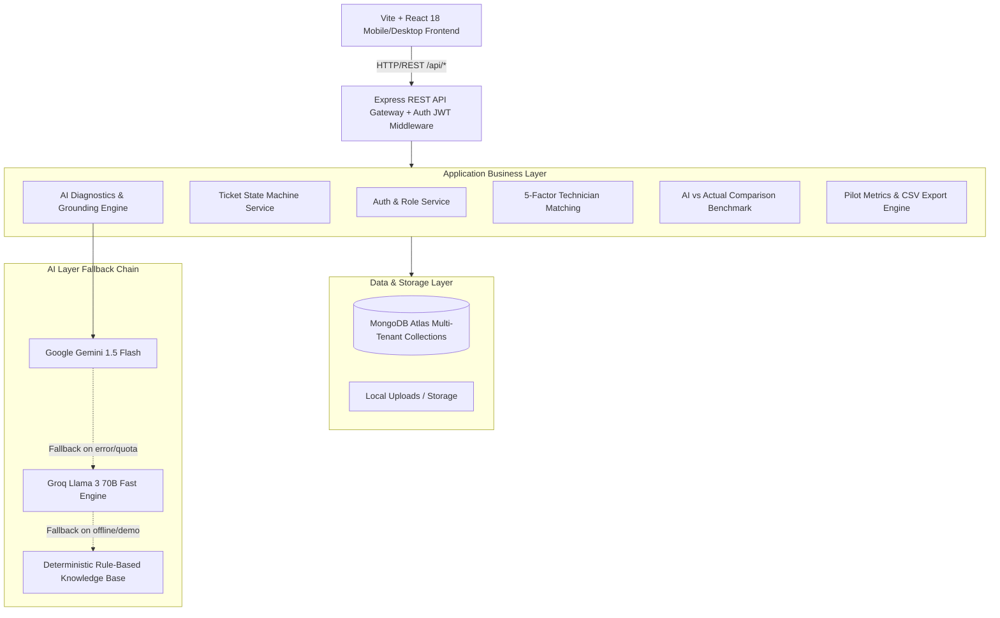
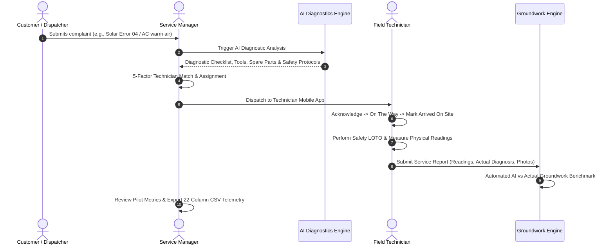

# Servora — AI-Powered Field Service Operations
### *Operational Co-pilot for Solar PV and AC / HVAC Field Service Businesses*

[](https://www.typescriptlang.org/)
[](https://react.dev/)
[](https://vitejs.dev/)
[](https://nodejs.org/)
[](https://expressjs.com/)
[](https://www.mongodb.com/)
[](https://tailwindcss.com/)
[](https://vitest.dev/)
[](https://www.linkedin.com/company/servoraaiop/)
[](#-license--intellectual-property)

---

## 📌 Executive Summary

**Servora** is an enterprise-grade operational management and AI assistance platform built specifically for field service companies running physical technician operations. 

Unlike consumer marketplaces or generic CRM ticketing tools, Servora bridges the critical operational gap between **complaint intake**, **grounded AI diagnostic preparation**, **deterministic skill-matching**, **mobile field execution**, **physical groundwork verification**, and **empirical AI-vs-Actual benchmarking**.

Servora is architected from day one to support two high-demand physical service verticals without code duplication:
1. ☀️ **Solar PV Systems**: Grid-tied, off-grid, and hybrid solar installations (photovoltaic panels, string inverters, charge controllers, net metering, battery storage).
2. ❄️ **AC / HVAC Systems**: Split, window, cassette, and package systems (compressor, condenser, evaporator, refrigerant cycle, electrical controls).

---

## 🎬 3-Minute Y Combinator Product Walkthrough

Servora includes an end-to-end recorded 3-minute video demonstration (`SERVORA_3MIN_YC_DEMO.mp4`) captured live from the operational environment without slides or mockups, showing how a high-priority service request moves through all three system portals in Mandvi, Kutch:



- **Video Demonstration**: [`SERVORA_3MIN_YC_DEMO.mp4`](./SERVORA_3MIN_YC_DEMO.mp4) (Full HD 1080p, 24fps, H.264)
- **Interactive In-App Walkthrough**: Visit `/walkthrough` in the portal to scrub through all 8 interactive milestones with real-time HUD telemetry.

---

## 🎯 The Operational Problem & The Servora Solution

| Operational Bottleneck | Industry Status Quo | The Servora Solution |
| :--- | :--- | :--- |
| **Pre-Arrival Diagnostic Blindness** | Technicians arrive on-site with zero preparation based only on a vague complaint like *"solar not working"* or *"AC warm"*. | Grounded AI analyzes the complaint, equipment brand/model, error codes, and past service history to build a 5-point pre-dispatch preparation package. |
| **Missing Tools & Spare Parts** | Up to 35% of first-time visits fail because the technician did not bring the required tool (e.g. MC4 crimper, manifold gauge) or spare part. | AI recommends mandatory tools and candidate spare parts *before dispatch*, preventing repeat truck rolls. |
| **Skill Mismatch & Random Dispatch** | Dispatchers assign whichever tech is nearest, even if they lack inverter certification or HVAC refrigerant experience. | Deterministic 5-factor scoring matches technicians based on vertical certification, skill matrix, proximity, onboard tools, and availability. |
| **Hallucinated / Unchecked AI** | Teams fear deploying AI that makes dangerous or inaccurate recommendations without verification. | AI is strictly labeled as assistant hypothesis. Technicians must record physical multimeter/gauge readings on-site to verify or refute AI. |
| **Lack of Operational Ground Truth** | Companies have no empirical data on whether AI recommendations actually matched real physical fault conditions. | Automated AI-vs-Actual benchmark engine tracks diagnostic match %, tool match %, part match %, and repeat visit rate with 22-column CSV export. |

---

## 📱 Designed for All Devices & Screen Sizes

Servora is engineered for seamless operation across desktop control centers and rugged mobile fieldwork:

- 📱 **Mobile Smartphones (320px – 480px)**:
  - Touch targets calibrated to $\ge 44\text{px}$ for gloved or field use.
  - High-contrast **Outdoor Field Mode** for readability in direct sunlight.
  - Fixed ergonomic thumb bottom bar for field technicians.
  - Slide-out navigation drawer with touch backdrop for mobile managers.
- 💻 **Tablets & Laptops (768px – 1024px)**:
  - Adaptive 2-column layouts for ticket triaging and customer equipment inspection.
  - Responsive modals for technician assignment and review.
- 🖥️ **Desktop & Ultrawide (1200px+)**:
  - Full-featured Operations Center with live pipeline queues, technician rosters, and Pilot Insights analytics.

---

## 🏗️ System Architecture



---

## 🔄 End-to-End Operational Lifecycle



---

## 🔑 Demo Access & Role-Based Permissions

The system includes pre-configured demo accounts to test both operational perspectives:

| Role | Email | Password | Access Scope |
| :--- | :--- | :--- | :--- |
| **Service Manager** | `manager@demo.com` | `Demo@12345` | Full access: Operations dashboard, ticket creation, AI analysis, 5-factor dispatch, customer directory, technician management, Pilot Insights, and CSV export. |
| **Field Technician** | `technician@demo.com` | `Demo@12345` | Fieldwork only: Assigned jobs queue, job progression (Accept $\to$ En Route $\to$ Arrived $\to$ Diagnosing $\to$ Repairing $\to$ Complete), physical reading capture, and report submission. *(Manager routes return `403 Forbidden`)* |

---

## 🛠️ Multi-Vertical Groundwork Configurations

### 1. Solar Photovoltaic (PV)
- **Equipment Attributes**: Capacity (kW), Panel Make/Model, Inverter Make/Model, System Type (`ON_GRID`, `OFF_GRID`, `HYBRID`), Battery Storage Present.
- **Physical Readings Required On-Site**:
  - String Open-Circuit Voltage ($V_{oc}$)
  - String Short-Circuit Current ($I_{sc}$)
  - Inverter AC Output Voltage ($V_{ac}$)
  - Grid Voltage ($V_{grid}$)
  - Earth Resistance ($\Omega$)
- **Mandatory Safety Protocols**: DC Disconnect isolation, Lockout-Tagout (LOTO), arc-flash PPE, rooftop fall protection.

### 2. AC / HVAC Systems
- **Equipment Attributes**: Tonnage (TR), AC Type (`SPLIT`, `WINDOW`, `CASSETTE`, `DUCTED`), Brand, Refrigerant Type (`R32`, `R410A`, `R22`).
- **Physical Readings Required On-Site**:
  - Indoor Room Temperature ($^\circ\text{C}$)
  - Grille Supply Air Temperature ($^\circ\text{C}$)
  - $\Delta T$ Cooling Differential ($^\circ\text{C}$)
  - Compressor Suction Line Pressure ($\text{PSI}$)
  - Running Current / Amperage ($A$)
- **Mandatory Safety Protocols**: Mains breaker isolation, refrigerant venting compliance, condenser fan pinch hazard verification.

---

## 📊 Pilot Validation Metrics & CSV Export

Servora tracks real-world operational KPIs directly against field ground truth:

1. **Diagnosis Match Rate**: Percentage of jobs where technician's verified on-site diagnosis matched the AI hypothesis.
2. **Tool Match Rate**: Percentage of recommended tools that were physically utilized during the repair.
3. **Part Prediction Rate**: Accuracy of pre-arrival replacement part predictions.
4. **Repeat Visit Rate**: Rate of secondary dispatches (lower indicates higher first-time fix rate).
5. **Technician AI Preparation Rating**: Subjective satisfaction rating ($1$ to $5$ stars) given by technicians on pre-dispatch preparation usefulness.
6. **22-Column CSV Export**: Comprehensive raw telemetry including ticket numbers, vertical, customer coordinates, AI hypotheses, physical readings, actual diagnoses, and technician feedback.

---

## 🚀 Quickstart & Local Installation

### Prerequisites
- **Node.js**: v18.0.0 or higher
- **npm**: v9.0.0 or higher
- **MongoDB**: Local instance or MongoDB Atlas cluster URI

### 1. Clone the Repository
```bash
git clone https://github.com/faizkhatri196/Servora.git
cd Servora
```

### 2. Install All Dependencies
```bash
npm run install:all
```
*Or install root, server, and client individually:*
```bash
npm install
npm --prefix server install
npm --prefix client install
```

### 3. Environment Configuration
Create `server/.env` based on `server/.env.example`:
```env
PORT=5000
NODE_ENV=development
CLIENT_URL=http://localhost:5173
MONGODB_URI=mongodb://localhost:27017/servora
JWT_SECRET=your_super_secret_jwt_key_min_32_chars_here
AI_PROVIDER=demo
```

Create `client/.env` based on `client/.env.example`:
```env
VITE_API_URL=http://localhost:5000
```

> **Note on AI Providers**: By default, `AI_PROVIDER=demo` runs completely offline with zero API cost using a deterministic knowledge engine. To use real LLMs, set `AI_PROVIDER=gemini` and provide `GEMINI_API_KEY`, or `AI_PROVIDER=groq` and provide `GROQ_API_KEY`.

### 4. Seed the Database
Populate 20 realistic service tickets, customer records, installed assets, and demo accounts:
```bash
npm run seed
```

### 5. Run the Application
Start both the backend server and frontend client concurrently:
```bash
npm run dev
```
- **Backend API**: [http://localhost:5000](http://localhost:5000) (Health check: `http://localhost:5000/health`)
- **Frontend App**: [http://localhost:5173](http://localhost:5173)

---

## 🧪 Automated Testing

Servora includes automated unit and integration tests covering the end-to-end workflow:
```bash
npm test
```
*Test suite validates:*
- Multi-vertical ticket creation and state machine progression.
- Grounded AI diagnostic generation and deterministic fallback.
- 5-factor technician matching scoring.
- Mobile service report submission with physical readings.
- Role-based authorization guards (`403 Forbidden` on unauthorized manager routes).
- Pilot telemetry calculation and CSV export generation.

---

## 🌐 Production Infrastructure Architecture

Servora is designed for cloud-native deployment with distributed frontend and microservice backend separation:

- **Frontend Tier**: Single-Page Application (SPA) built with React 18, Vite, and Tailwind CSS.
- **Backend Tier**: Node.js & Express REST API with TypeScript, JWT authentication, and real-time operational state machine.
- **Data Tier**: MongoDB Atlas multi-tenant cluster with geospatial indexing and automated telemetry collection.
- **AI Processing**: Grounded field diagnostic preparation engine supporting dynamic provider switching.

---

## 📡 REST API Reference

| Method | Endpoint | Access | Description |
| :--- | :--- | :--- | :--- |
| `GET` | `/health` | Public | System health check (`{"status":"ok"}`) |
| `POST` | `/api/auth/login` | Public | Authenticate user and issue JWT cookie/token |
| `GET` | `/api/auth/me` | Authenticated | Retrieve profile of currently logged-in user |
| `GET` | `/api/tickets` | Authenticated | List tickets (filtered by role and vertical) |
| `POST` | `/api/tickets` | Manager | Create new service request with asset context |
| `GET` | `/api/tickets/:id` | Authenticated | Get ticket details, asset history, and report |
| `POST` | `/api/tickets/:id/analyze` | Manager | Run grounded AI diagnostic preparation |
| `GET` | `/api/tickets/:id/recommended-technicians` | Manager | Compute 5-factor technician match scores |
| `POST` | `/api/tickets/:id/assign` | Manager | Assign certified technician to ticket |
| `PATCH` | `/api/tickets/:id/status` | Authenticated | Advance ticket state machine |
| `POST` | `/api/service-reports/:id` | Technician | Submit fieldwork report with physical readings |
| `GET` | `/api/pilot/metrics` | Manager | Retrieve aggregated pilot evaluation rates |
| `GET` | `/api/pilot/export.csv` | Manager | Download 22-column pilot evaluation telemetry |

---

## 🔒 Security & Safe Operations

- **Strict Role Separation**: Technicians cannot access manager endpoints or reassign jobs.
- **Physical Safety First**: Fall protection PPE, Arc-Flash safety, and Lockout-Tagout (LOTO) isolation are enforced in both the AI checklist and field reporting forms.
- **Transparent AI Disclaimers**: All AI outputs carry clear assistance notices (`AI ASSISTANCE — VERIFY ON SITE`).
- **Zero Public Secret Leaks**: All credentials and database connection strings are stored in environment variables, excluded from git via strict `.gitignore` rules.

---

## 🌐 Connect with Servora

- 💼 **Official LinkedIn**: [Servora Technologies on LinkedIn](https://www.linkedin.com/company/servoraaiop/)
- 🏢 **Operations Verticals**: Solar Photovoltaics (PV) & AC / HVAC Field Operations

---

## 🔒 License & Intellectual Property

Copyright © 2026 Servora Technologies. All rights reserved.

This software, source code, system architecture, operational workflows, scoring algorithms, and associated documentation are **confidential and proprietary**.

- **Proprietary & Confidential**: Unauthorized copying, distribution, reproduction, reverse engineering, sublicensing, or public dissemination of this codebase or any portion thereof is strictly prohibited without explicit prior written authorization from Servora Technologies.
- **Pilot & Evaluation Grant**: Access is granted solely for authorized demonstration, operational pilot testing, and evaluation purposes under direct agreement with Servora Technologies.