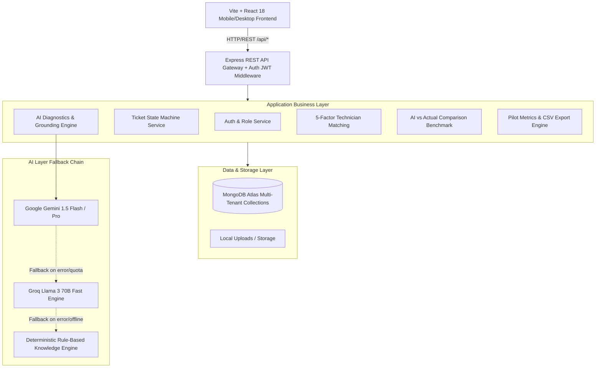

# System Architecture — AI Field Service Copilot (Solar & AC/HVAC)

## 1. System Overview

**AI Field Service Copilot** is an enterprise-grade operational management and AI assistance platform built specifically for field service companies running physical technician operations. It bridges customer complaint intake, grounded AI diagnostic preparation, deterministic technician skill-matching, mobile field execution, physical groundwork verification, and empirical AI-vs-Actual benchmarking.

The system is architected from day one to support multiple physical service verticals without code duplication:
- **Solar PV Systems**: Grid-tied, off-grid, and hybrid installations (panels, inverters, charge controllers, string combiners, net metering, battery storage).
- **AC / HVAC Systems**: Split, window, cassette, and package systems (compressor, condenser, evaporator, refrigerant cycle, electrical controls).

---

## 2. Multi-Service Configuration Layer

Rather than building vertical-specific forks or hard-coding solar vs AC logic across models, the platform uses declarative service configurations:

### `server/src/config/serviceConfigs/solarConfig.ts`
- **Asset Fields**: System capacity (kW), Panel type (Monocrystalline, Polycrystalline, Bifacial), Inverter brand/model, Battery storage, Grid connection status, Installation date.
- **Physical Readings Required On-Site**:
  - `stringVoc`: String Open-Circuit Voltage ($V$)
  - `stringIsc`: String Short-Circuit Current ($A$)
  - `inverterAcOutputVoltage`: Inverter AC Output Voltage ($V$)
  - `gridVoltage`: Grid AC Voltage ($V$)
  - `batteryVoltage`: Battery Bank Voltage ($V$)
  - `groundResistance`: Earthing Resistance ($\Omega$)
  - `ambientTemp`: Ambient Outdoor Temperature ($^\circ\text{C}$)
- **Mandatory Safety Protocols**: DC Disconnect isolation, lockout-tagout (LOTO), arc-flash safety, fall protection PPE for rooftop access.

### `server/src/config/serviceConfigs/acConfig.ts`
- **Asset Fields**: Tonnage (Tons), Refrigerant type (R32, R410A, R22, R134a), Inverter AC technology, Star rating, Compressors, Indoor/outdoor unit IDs.
- **Physical Readings Required On-Site**:
  - `suctionPressure`: Suction Line Pressure ($\text{PSI}$)
  - `dischargePressure`: Discharge Line Pressure ($\text{PSI}$)
  - `supplyAirTemp`: Supply Air Vent Temperature ($^\circ\text{C}$)
  - `returnAirTemp`: Return Air Intake Temperature ($^\circ\text{C}$)
  - `runningCurrent`: Running Current / Amperage ($A$)
  - `capacitorHealth`: Starting/Run Capacitor Capacitance ($\mu\text{F}$)
  - `drainClear`: Condensate Drain Free Flow Verification ($\text{boolean}$)
- **Mandatory Safety Protocols**: Mains breaker isolation, refrigerant venting prevention (environmental compliance), rotating fan blade hazard checks, electrical grounding.

---

## 3. Grounded AI Layer Architecture

The AI subsystem operates under a **Strict Assistant** paradigm:
1. **Grounded Prompts**: The prompt injected into the LLM includes:
   - Specific system technical specs (e.g., 5kW Solis inverter with monocrystalline array).
   - Past service history for this specific asset (preventing amnesia).
   - Common failure modes and technical reference data from `solarKnowledge.ts` or `acKnowledge.ts`.
2. **Structured Zod Schema Validation**: AI output is parsed and strictly validated via `aiOutputSchema`:
   - `possibleIssues`: Array of issues with probability, root causes, severity.
   - `recommendedChecklist`: Step-by-step diagnostic checks.
   - `requiredTools`: List of tools with reason and whether they are mandatory.
   - `expectedParts`: Anticipated replacement parts with estimated probability.
   - `safetyWarnings`: Critical precautions for physical safety.
   - `estimatedDurationMinutes`: Time estimation for scheduling.
3. **Resilient Provider Fallback Chain**:
   - Primary: **Google Gemini 1.5 Flash** (via `@google/genai`).
   - Secondary: **Groq Llama 3 70B** (via `groq-sdk`).
   - Tertiary: **DemoAIProvider** (zero-network deterministic knowledge base matching complaint keywords, ensuring uninterrupted demos even without internet or when API quotas are exceeded).
4. **Transparent Labeling**: AI outputs are visibly marked in both the API and the UI:
   - `provider`: `GEMINI` | `GROQ` | `DEMO`
   - `warning`: `"AI ASSISTANCE — VERIFY ON SITE"` (displayed prominently to prevent blind trust).

---

## 4. Deterministic 5-Factor Technician Matching

Technician selection rejects fuzzy black-box models in favor of an explainable, auditable multi-factor formula:

$$\text{Total Score} = (S \times 0.40) + (T \times 0.20) + (A \times 0.20) + (D \times 0.10) + (E \times 0.10)$$

Where:
- **Service Type Hard Filter**: Technicians not certified in the ticket's `serviceType` are disqualified ($0$ score, marked incompatible).
- **Skill Match ($S$, 40%)**: Ratio of required skills (identified by AI diagnostic analysis) possessed by the technician.
- **Tool Match ($T$, 20%)**: Ratio of mandatory diagnostic tools in the technician's equipped inventory.
- **Availability ($A$, 20%)**: 100% if `AVAILABLE` with $<2$ active jobs; 50% if 2–3 jobs; 25% if `BUSY`; 0% if `OFFLINE`.
- **Area / Distance Match ($D$, 10%)**: Matching service territory / cluster to minimize transit time.
- **Experience Match ($E$, 10%)**: Normalized weighting for years of field experience in that service vertical.

Every recommendation returns a machine-readable array of human-readable `reasons`, giving service managers full transparency before dispatch.

---

## 5. Mobile-First Fieldwork & Ground Truth Verification

The field technician interface is designed for real-world field conditions (high outdoor contrast, large tap targets, tactile progress bar):
1. **Phase-Gated State Machine**:
   $$\text{ASSIGNED} \rightarrow \text{ACCEPTED} \rightarrow \text{EN\_ROUTE} \rightarrow \text{ON\_SITE} \rightarrow \text{IN\_PROGRESS} \rightarrow \text{COMPLETED}$$
2. **Physical Data Capture**:
   Technicians cannot complete a job without entering actual physical readings, verified root causes, replaced parts (with serial numbers), labor hours, and photo evidence.
3. **Automated AI vs Actual Benchmark**:
   Upon report submission, the `evaluationService` computes:
   - `issuePredictionMatched`: Was the actual root cause in the AI's top predicted issues?
   - `partsPredictionMatched`: Were the actual parts used among the AI's expected parts?
   - `toolsMatchRate`: Did the technician need tools not suggested by the AI?
   - `durationVarianceMinutes`: Actual time vs AI predicted time.
   - `technicianFeedbackRating`: 1–5 star rating from the technician on AI usefulness.

This feedback loop continually grounds operational insights, visible to managers in the **Pilot Evaluation Dashboard**.
