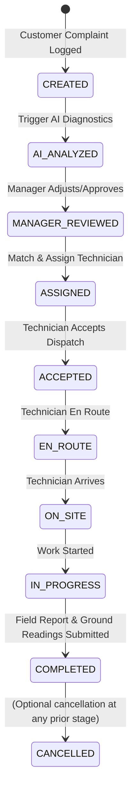

# Database Architecture & Data Dictionary

## 1. Overview & Multi-Tenancy Design

AI Field Service Copilot uses **MongoDB** (with Mongoose ODM) with strict tenant isolation:
- Every data model contains an indexed `companyId: { type: Schema.Types.ObjectId, ref: 'Company', required: true, index: true }`.
- Multi-tenancy is enforced at the controller layer by extracting `companyId` strictly from the authenticated JWT session.
- Composite indexes ensure sub-millisecond lookups while isolating data across customer companies.

---

## 2. Collections & Schemas

### 2.1. `companies`
Stores field-service organizations.
| Field | Type | Description |
|---|---|---|
| `_id` | ObjectId | Primary Key |
| `name` | String | Organization name (e.g., "Apex Renewable & HVAC Services") |
| `slug` | String | Unique company slug |
| `activeServices` | [String] | Enabled verticals: `['SOLAR', 'AC_HVAC']` |
| `createdAt` / `updatedAt` | Date | Audit timestamps |

### 2.2. `users`
Operational user accounts for authentication.
| Field | Type | Description |
|---|---|---|
| `_id` | ObjectId | Primary Key |
| `companyId` | ObjectId | Tenant reference |
| `email` | String | Unique email address |
| `password` | String | Bcrypt-hashed password (salt rounds: 10) |
| `name` | String | Display name |
| `role` | String | `SERVICE_MANAGER` \| `TECHNICIAN` |
| `technicianId` | ObjectId | Optional reference to `technicians` collection for field users |

### 2.3. `technicians`
Field technician profiles, capabilities, and real-time operational status.
| Field | Type | Description |
|---|---|---|
| `companyId` | ObjectId | Tenant reference |
| `userId` | ObjectId | Linked user account |
| `name` | String | Technician full name |
| `phone` | String | Contact phone number |
| `serviceTypes` | [String] | Array: `['SOLAR']`, `['AC_HVAC']`, or `['SOLAR', 'AC_HVAC']` |
| `skills` | [String] | e.g., `['Inverter Diagnostics', 'Refrigerant Recovery', ...]` |
| `tools` | [String] | Equipped tools: `['Digital Multimeter', 'Manifold Gauge Set', ...]` |
| `experienceYears`| Number | Years of physical field experience |
| `serviceArea` | String | Territory / cluster (e.g., "West Suburbs", "North Sector") |
| `status` | String | `AVAILABLE` \| `BUSY` \| `OFFLINE` |
| `activeTicketCount`| Number | Currently dispatched active jobs |
| `rating` | Number | Historic performance rating (1.0 – 5.0) |

### 2.4. `customers`
Asset owners / physical site locations.
| Field | Type | Description |
|---|---|---|
| `companyId` | ObjectId | Tenant reference |
| `name` | String | Customer or site manager name |
| `phone` | String | Contact phone |
| `email` | String | Email address |
| `address` | Object | `{ street, city, state, postalCode, landmark, coordinates }` |
| `serviceType` | String | Preferred or primary service vertical |

### 2.5. `solarsystems`
Solar rooftop / ground-mount physical installations.
| Field | Type | Description |
|---|---|---|
| `companyId` | ObjectId | Tenant reference |
| `customerId` | ObjectId | Customer reference |
| `capacityKw` | Number | System size in kW (e.g., 5.0, 10.0, 25.0) |
| `panelType` | String | `MONOCRYSTALLINE` \| `POLYCRYSTALLINE` \| `BIFACIAL` |
| `panelBrand` | String | Brand (e.g., "Tata Power Solar", "Waaree", "Vikram") |
| `panelCount` | Number | Total physical panel count |
| `inverterBrand` | String | Inverter brand (e.g., "Solis", "Growatt", "SMA", "Fronius") |
| `inverterModel` | String | Model code |
| `batteryStorage` | Boolean | True if battery backup is installed |
| `batteryDetails` | String | Battery specs / capacity if present |
| `gridTied` | Boolean | True if net-metered grid-connected |
| `installationDate`| Date | Commissioning date |

### 2.6. `acunits`
Air conditioning / HVAC indoor and outdoor physical units.
| Field | Type | Description |
|---|---|---|
| `companyId` | ObjectId | Tenant reference |
| `customerId` | ObjectId | Customer reference |
| `brand` | String | Brand (e.g., "Daikin", "Voltas", "Blue Star", "Carrier") |
| `modelNumber` | String | Model identifier |
| `unitType` | String | `SPLIT` \| `WINDOW` \| `CASSETTE` \| `PACKAGE` |
| `tonnage` | Number | Capacity in tons (e.g., 1.5, 2.0, 3.0) |
| `refrigerantType`| String | `R32` \| `R410A` \| `R22` \| `R134A` |
| `inverter` | Boolean | Inverter compressor technology |
| `starRating` | Number | Energy efficiency rating (1–5 stars) |
| `location` | String | Physical unit placement (e.g., "Server Room 2nd Floor") |

### 2.7. `servicetickets`
Central operational entity tracking service life-cycle.
| Field | Type | Description |
|---|---|---|
| `companyId` | ObjectId | Tenant reference |
| `ticketNumber` | String | Formatted human identifier: `SOL-2026-XXXX` or `AC-2026-XXXX` |
| `serviceType` | String | `SOLAR` \| `AC_HVAC` |
| `customerId` | ObjectId | Customer reference |
| `solarSystemId` | ObjectId | Optional linked solar installation |
| `acUnitId` | ObjectId | Optional linked AC equipment |
| `complaint` | String | Raw customer complaint description |
| `priority` | String | `LOW` \| `MEDIUM` \| `HIGH` \| `CRITICAL` |
| `status` | String | State machine status (see Section 3) |
| `assignedTechnicianId`| ObjectId | Dispatched technician reference |
| `photos` | [String] | Intake and evidence photo paths |
| `historyTimeline`| [Object] | Array of state transitions: `{ status, timestamp, changedBy, note }` |

### 2.8. `aianalyses`
Grounded AI diagnostic recommendations.
| Field | Type | Description |
|---|---|---|
| `ticketId` | ObjectId | Associated ticket |
| `provider` | String | `GEMINI` \| `GROQ` \| `DEMO` |
| `summary` | String | Diagnostic summary for technicians and managers |
| `possibleIssues` | [Object] | `[{ issue, probability, rootCauses, severity }]` |
| `recommendedChecklist` | [String] | Prescriptive step-by-step field verification steps |
| `requiredTools` | [Object] | `[{ tool, reason, isMandatory }]` |
| `expectedParts` | [Object] | `[{ partName, probability, estimatedCost }]` |
| `safetyWarnings` | [String] | Critical physical safety hazards |
| `estimatedDurationMinutes`| Number | Expected on-site labor minutes |

### 2.9. `servicereports`
Physical fieldwork documentation completed on-site by the technician.
| Field | Type | Description |
|---|---|---|
| `ticketId` | ObjectId | Associated ticket |
| `technicianId` | ObjectId | Fulfilling technician |
| `actualRootCause` | String | Physical verified root cause |
| `workPerformed` | String | Technical narrative of repairs conducted |
| `partsUsed` | [Object] | `[{ partName, partNumber, quantity, cost }]` |
| `toolsUsed` | [String] | Actual tools utilized |
| `laborMinutes` | Number | Actual time spent on site |
| `readings` | Object | Vertical-specific physical sensor/multimeter readings |
| `photos` | [String] | Before/after photographic evidence |
| `technicianRatingOfAI`| Number | 1–5 score on AI utility |
| `technicianNotesOnAI`| String | Technician comments on AI accuracy or gaps |

### 2.10. `aianalysisreviews`
Empirical AI vs Groundwork verification benchmark.
| Field | Type | Description |
|---|---|---|
| `ticketId` | ObjectId | Associated ticket |
| `issuePredictionMatched` | Boolean | Was actual root cause predicted by AI? |
| `partsPredictionMatched` | Boolean | Were actual parts in AI expected parts? |
| `toolsMatchRate` | Number | Percentage of required tools predicted |
| `durationVarianceMinutes`| Number | Actual time vs AI predicted time |

---

## 3. Ticket State Machine Transitions

Transitions are strictly validated in `server/src/services/ticketService.ts`:
- Any invalid state jump triggers a `400 Bad Request` with an explanatory error.
- Every state change automatically logs an entry in the ticket's `historyTimeline` with timestamp and user ID.
