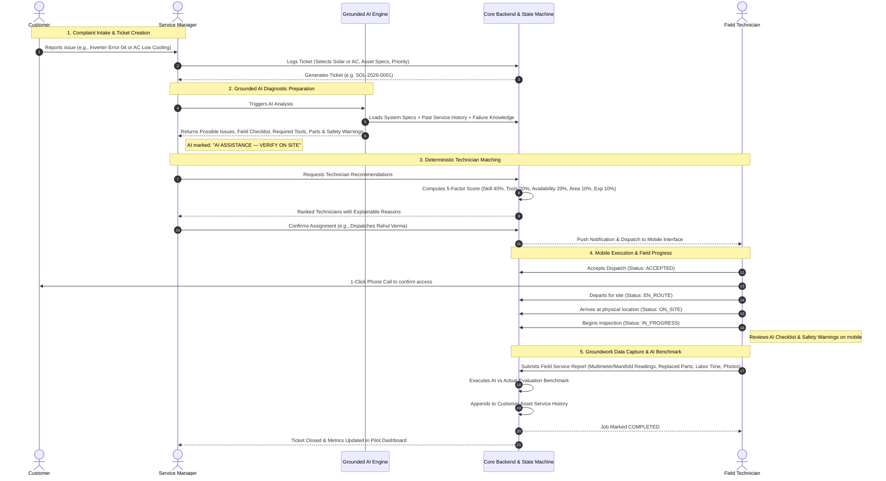

# End-to-End Operational Workflow

This document illustrates the step-by-step lifecycle of a field service request in AI Field Service Copilot, showing the interaction between the Customer, Service Manager, AI Diagnostics Subsystem, and Field Technician.

---

## Key Operational Safeguards

1. **Manager in the Loop**: The AI never auto-assigns or auto-dispatches tickets without explicit operational review by a human Service Manager.
2. **Technician Ground Truth**: The physical readings recorded on site (e.g., actual DC string voltage, AC line voltage, suction pressure) and the physical parts used supersede any predictive AI assumptions.
3. **Audit Trail**: Every change in ticket status or field assignment is preserved in the ticket's `historyTimeline` with user references and timestamps.
4. **Asset History Continuity**: Every completed job becomes part of the asset's permanent history, ensuring the next technician and AI analysis are grounded in past maintenance context.
